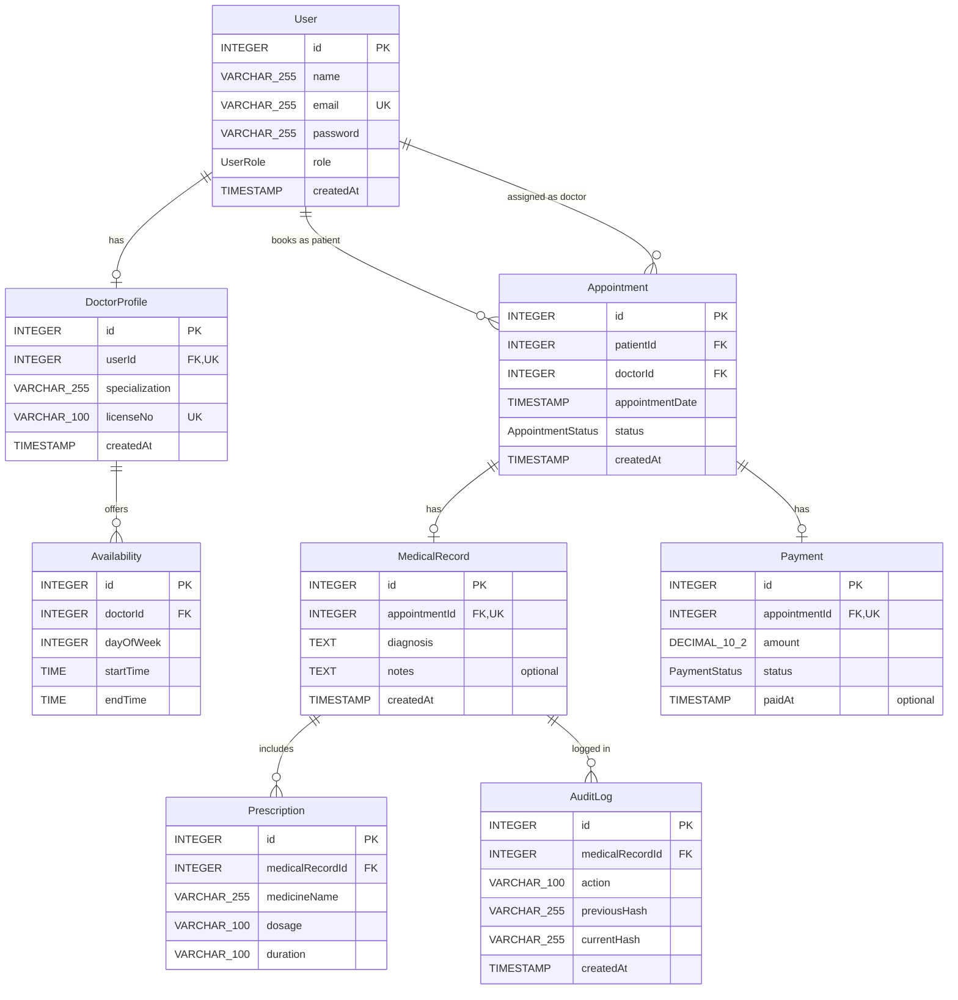

# ER Diagram

Mermaid entity-relationship diagram for the eight HealthChain tables. Column names, types, and nullability match `relational-schema.md` and `data-dictionary.md`. `MedicalRecord.notes` and `Payment.paidAt` are optional.

